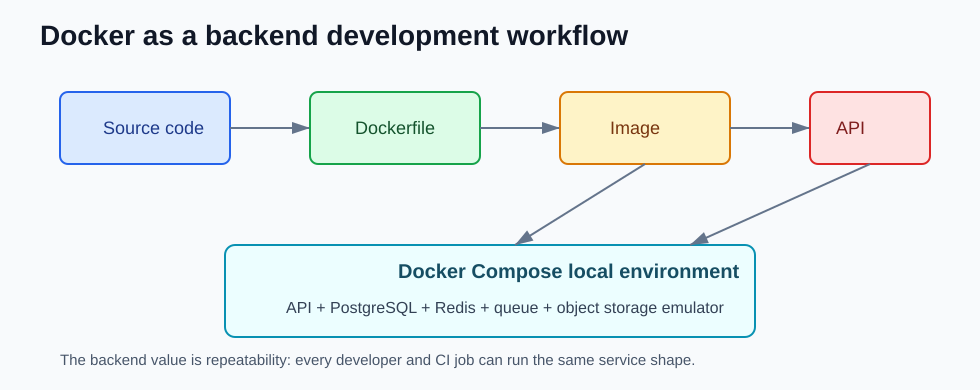

# Docker Core Concepts for Backend Developers

This page is the short Docker mental model that matters before reading version changes.



## Image vs Container

```text
Dockerfile -> image -> running container
```

The image is the packaged backend service. The container is a running process created from that image.

## Compose for Local Dependencies

Compose is the local contract for backend dependencies.

```yaml
services:
  api:
    build: .
    ports:
      - "8080:8080"
    environment:
      SPRING_DATASOURCE_URL: jdbc:postgresql://postgres:5432/app

  postgres:
    image: postgres:16
```

Inside Docker, services talk by service name:

```text
postgres:5432
```

From the host machine, use the published port:

```text
localhost:5432
```

## Debugging Containers

```bash
docker compose ps
docker compose logs -f api
docker compose exec api sh
docker inspect my-container
docker stats
```

## Critical Rules

- Use multi-stage Dockerfiles for backend services.
- Do not bake secrets into images.
- Keep local Compose close to production shape, but not identical to production infrastructure.
- Treat Docker daemon access as host-level access.

## References

- Docker Engine release notes: https://docs.docker.com/engine/release-notes/
- Docker Compose secrets: https://docs.docker.com/compose/how-tos/use-secrets/
