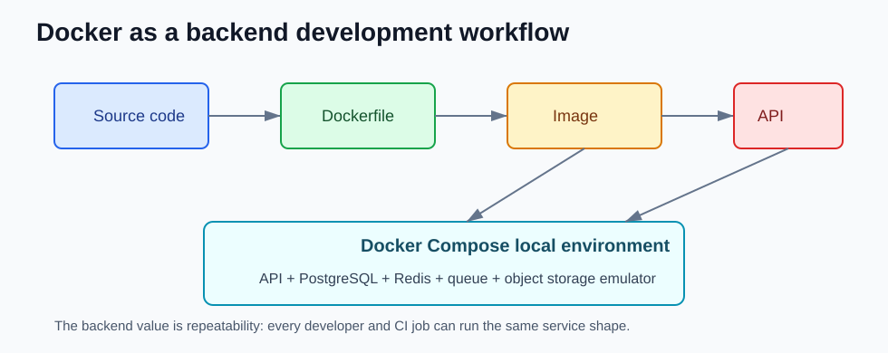

# Docker for Backend Developers

Docker Engine does not use Java-style LTS labels in the official release notes. So, for this stack, the pages below use the stable Engine release branches from 2018 onward.

Each page explains the difference compared with the previous listed Docker Engine version, with a backend developer focus: builds, local environments, networking, debugging, CI images, and the small amount of infrastructure context that affects application teams.



## Versions

- [Docker 29.x](docker29.md)
- [Docker 28.x](docker28.md)
- [Docker 27.x](docker27.md)
- [Docker 26.x](docker26.md)
- [Docker 25.0](docker25.md)
- [Docker 24.0](docker24.md)
- [Docker 23.0](docker23.md)
- [Docker 20.10](docker20-10.md)
- [Docker 19.03](docker19-03.md)
- [Docker 18.09](docker18-09.md)

## Backend Mental Model

```text
source code -> Dockerfile -> image -> container
                         \-> Compose -> app + database + cache + queue
```

The image is the packaged application. The container is a running process created from that image. Compose is the local environment that lets your API run beside dependencies like PostgreSQL, Redis, Kafka, RabbitMQ, or LocalStack.

## References

- Docker Engine release notes: https://docs.docker.com/engine/release-notes/
- Docker Build secrets: https://docs.docker.com/build/building/secrets/
- Docker Compose secrets: https://docs.docker.com/compose/how-tos/use-secrets/
- Docker Compose Watch: https://docs.docker.com/compose/how-tos/file-watch/
