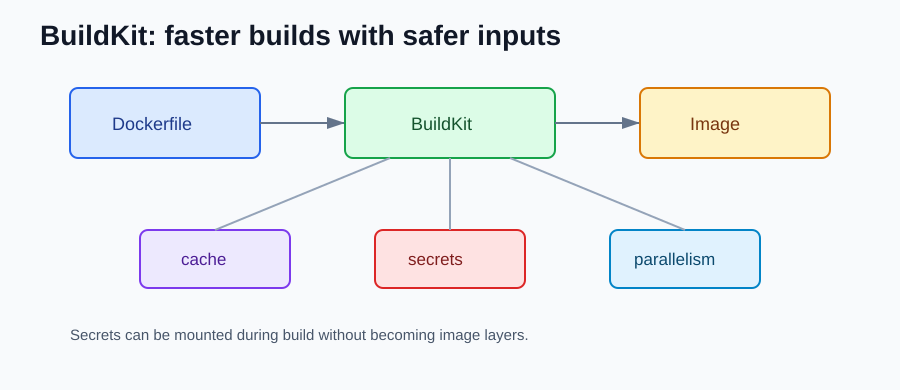
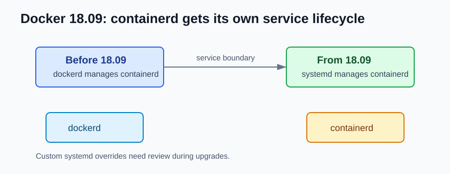

# Docker 18.09 NEW Features

Compared with Docker 18.06, Docker 18.09 is the first version in this project because it is the main 2018 backend migration point.

## BuildKit Starts Becoming Real

BuildKit became available as a better build backend.

```bash
DOCKER_BUILDKIT=1 docker build -t my-api .
```



For backend developers, this matters because builds can become faster and easier to read. It also opened the path for better cache handling and safer secrets in later versions.

## Better Multi-stage Build Experience

Multi-stage builds were already possible, but BuildKit made the build flow more useful for real services.

```dockerfile
FROM eclipse-temurin:21-jdk AS build
WORKDIR /app
COPY . .
RUN ./mvnw -DskipTests package

FROM eclipse-temurin:21-jre
WORKDIR /app
COPY --from=build /app/target/api.jar api.jar
ENTRYPOINT ["java", "-jar", "api.jar"]
```

The backend benefit is simple: keep Maven, Gradle, npm, or other build tools out of the runtime image.

## containerd Managed by systemd

Before 18.09, `containerd` was managed by the Docker daemon. From 18.09, `containerd` is managed by `systemd` on systemd-based Linux systems.



Most backend developers do not touch this every day, but it matters when a local Linux dev box or CI runner has custom Docker service overrides.

## Legacy and Platform Cleanup

Docker 18.09 removed older platform support and old TLS behavior. For application teams, this mostly means old CI agents and old Linux distributions may need upgrades before Docker itself can move forward.

## What should I check after upgrading?

- Try `DOCKER_BUILDKIT=1` in local builds.
- Use multi-stage Dockerfiles for compiled services.
- Review old CI agents before upgrading Docker.
- Ask infrastructure teams before changing custom `docker.service` overrides.

## References

- Docker Engine 18.09 release notes: https://docs.docker.com/engine/release-notes/18.09/
