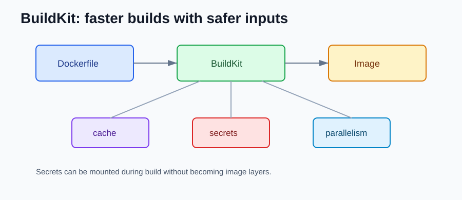

# Docker 18.09 to 20.10 NEW Features

Compared with older Docker releases, this period starts modern backend Docker usage: BuildKit, better builds, Docker contexts, and safer daemon behavior.

## BuildKit

```bash
DOCKER_BUILDKIT=1 docker build -t my-api .
```



Why it matters:

- faster builds
- better cache behavior
- clearer build output
- safer path for build secrets

## Multi-stage Builds

```dockerfile
FROM eclipse-temurin:21-jdk AS build
WORKDIR /app
COPY . .
RUN ./mvnw -DskipTests package

FROM eclipse-temurin:21-jre
WORKDIR /app
COPY --from=build /app/target/api.jar api.jar
ENTRYPOINT ["java", "-jar", "api.jar"]
```

Production images should contain the runtime app, not Maven, Gradle, compilers, or local build cache.

## Docker Contexts

```bash
docker context ls
docker context use local
```

Use contexts to switch between local Docker, remote test hosts, and CI-like environments.

## Safer Daemon Access

Access to the Docker daemon is close to host-level access.

Avoid exposing the Docker TCP API without strong authentication and network controls.

## What should I check after upgrading?

- Use BuildKit for local and CI builds.
- Use multi-stage Dockerfiles.
- Do not expose the Docker daemon casually.
- Check old CI agents before upgrading.

## References

- Docker Engine 18.09 release notes: https://docs.docker.com/engine/release-notes/18.09/
- Docker Engine 19.03 release notes: https://docs.docker.com/engine/release-notes/19.03/
- Docker Engine 20.10 release notes: https://docs.docker.com/engine/release-notes/20.10/
