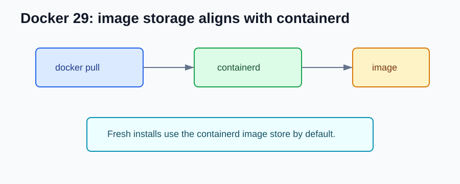

# Docker 29.x NEW Features

Compared with Docker 28.x, Docker 29.x is an important migration release because it includes breaking changes.

## containerd Image Store by Default

For fresh installs, the containerd image store became the default.



The old mental model was:

```text
docker pull -> Docker graphdriver image store
```

The newer direction is:

```text
docker pull -> containerd image store
```

For backend teams, this affects image-heavy workflows first: CI builds, image save/load, scanners, and promotion pipelines.

## Docker Content Trust Removed from the CLI

Docker Content Trust was removed from the Docker CLI in 29.0.

If you relied on this:

```bash
DOCKER_CONTENT_TRUST=1 docker pull my-company/my-api:1.0.0
```

Plan a migration to current signing and supply-chain tooling before upgrading shared environments.

## cgroup v1 Deprecated

cgroup v1 was deprecated. Docker says support continues until at least May 2029, but new Linux hosts should move to cgroup v2.

```bash
docker info | grep -i cgroup
```

This matters for backend workloads that set memory or CPU limits in Compose, CI, or container platforms.

## What should I check after upgrading?

- Test build, push, pull, save, load, and scan workflows.
- Check whether CI workers are fresh installs or upgraded installs.
- Audit any use of `DOCKER_CONTENT_TRUST`.
- Check cgroup mode on Linux hosts.
- Run load tests for services with strict CPU or memory limits.

## References

- Docker Engine 29 release notes: https://docs.docker.com/engine/release-notes/29/
