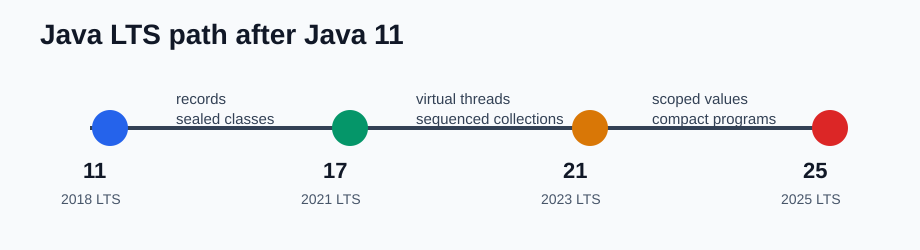
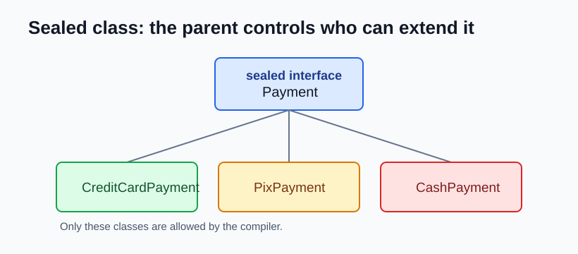

# Java 17 NEW Features

Java 17 is an LTS release. Compared with Java 11, it is mostly about making the language more expressive and making the JVM stricter, safer, and easier to run in production.



## Sealed Classes

Sealed classes let you say exactly which classes can extend or implement a type. This is useful when the parent type represents a small, known set of possibilities.



```java
public sealed interface Payment
    permits CreditCardPayment, PixPayment, CashPayment {
}

public final class CreditCardPayment implements Payment {
}

public final class PixPayment implements Payment {
}

public final class CashPayment implements Payment {
}
```

Why it matters:

- You keep inheritance under control.
- The compiler can understand all possible children.
- It works very well with pattern matching and switch in newer versions.

## Records

Records are a compact way to create immutable data carrier classes.

Before Java 17:

```java
public final class User {
    private final String name;
    private final String email;

    public User(String name, String email) {
        this.name = name;
        this.email = email;
    }

    public String name() {
        return name;
    }

    public String email() {
        return email;
    }
}
```

With records:

```java
public record User(String name, String email) {
}
```

The compiler creates the constructor, accessors, `equals`, `hashCode`, and `toString`.

## Pattern Matching for instanceof

Before Java 17, you had to test the type and then cast manually.

```java
if (value instanceof String) {
    String text = (String) value;
    System.out.println(text.toUpperCase());
}
```

Now the variable is created directly by the `instanceof` check.

```java
if (value instanceof String text) {
    System.out.println(text.toUpperCase());
}
```

This removes boilerplate and reduces casting mistakes.

## Text Blocks

Text blocks make multiline strings easier to read.

```java
String json = """
    {
      "name": "Ana",
      "active": true
    }
    """;
```

This is very useful for JSON, SQL, HTML, and test fixtures.

## Switch Expressions

Switch can now return a value. You can use `->` to avoid accidental fall-through.

```java
String label = switch (status) {
    case 200 -> "OK";
    case 404 -> "Not found";
    case 500 -> "Server error";
    default -> "Unknown";
};
```

## Helpful NullPointerExceptions

The JVM can show which part of an expression was null.

```java
order.getCustomer().getAddress().getCity();
```

Instead of only saying `NullPointerException`, the message can point to the exact variable or method result that was null.

## Strong Encapsulation of JDK Internals

Java 17 strongly encapsulates internal JDK APIs. Code that depends on private `sun.*` or other internal APIs can break.

The good side is that applications become more portable and less dependent on implementation details. The migration rule is simple: prefer supported public APIs.

## New Random Number Generator API

Java 17 adds better APIs for random generators.

```java
RandomGenerator generator = RandomGenerator.of("L64X128MixRandom");

int number = generator.nextInt(1, 101);
```

This makes it easier to choose the right generator for simulations, tests, or general application code.

## References

- OpenJDK JDK 17 project: https://openjdk.org/projects/jdk/17/
- Oracle Java SE Support Roadmap: https://www.oracle.com/java/technologies/java-se-support-roadmap.html
