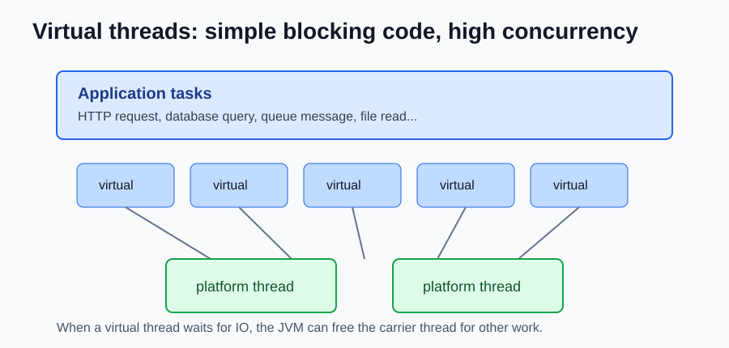

# Java 21 NEW Features

Java 21 is an LTS release. Compared with Java 17, the biggest change is virtual threads: Java can handle many blocking tasks with a much simpler programming model.



## Virtual Threads

Virtual threads are lightweight threads managed by the JVM. They are great for server applications that wait for I/O, like HTTP calls, database calls, queues, and files.

Before Java 21, a common server style was:

```java
ExecutorService executor = Executors.newFixedThreadPool(100);

executor.submit(() -> {
    var user = userClient.findById(id);
    var orders = orderClient.findByUser(id);
    return new UserSummary(user, orders);
});
```

With virtual threads:

```java
try (var executor = Executors.newVirtualThreadPerTaskExecutor()) {
    Future<UserSummary> summary = executor.submit(() -> {
        var user = userClient.findById(id);
        var orders = orderClient.findByUser(id);
        return new UserSummary(user, orders);
    });

    return summary.get();
}
```

The code still looks blocking, but the JVM can park the virtual thread while it waits and use the carrier platform thread for other work.

## Sequenced Collections

Java collections finally got a common API for "first", "last", and reversed views.

```java
SequencedCollection<String> names = new ArrayList<>();

names.addFirst("Ana");
names.addLast("Bruno");

System.out.println(names.getFirst()); // Ana
System.out.println(names.getLast());  // Bruno

SequencedCollection<String> reversed = names.reversed();
```

This works across ordered collections, sets, and maps through:

- `SequencedCollection`
- `SequencedSet`
- `SequencedMap`

## Pattern Matching for switch

Switch can now work naturally with types.

```java
String describe(Object value) {
    return switch (value) {
        case Integer i -> "int: " + i;
        case Long l -> "long: " + l;
        case String s -> "text: " + s;
        case null -> "null";
        default -> "unknown";
    };
}
```

This makes code easier to read when you need different behavior for different object shapes.

## Record Patterns

Record patterns let you unpack records directly.

```java
record Point(int x, int y) {
}

void print(Object value) {
    if (value instanceof Point(int x, int y)) {
        System.out.println("x=" + x + ", y=" + y);
    }
}
```

This is especially useful when records are nested.

```java
record Address(String city) {
}

record Customer(String name, Address address) {
}

if (value instanceof Customer(String name, Address(String city))) {
    System.out.println(name + " lives in " + city);
}
```

## Structured Concurrency Preview

Structured concurrency gives related tasks a clear parent scope. If one task fails, the scope can cancel the others.

```java
try (var scope = new StructuredTaskScope.ShutdownOnFailure()) {
    StructuredTaskScope.Subtask<User> user =
        scope.fork(() -> userClient.findById(id));

    StructuredTaskScope.Subtask<List<Order>> orders =
        scope.fork(() -> orderClient.findByUser(id));

    scope.join();
    scope.throwIfFailed();

    return new UserSummary(user.get(), orders.get());
}
```

This feature is preview in Java 21, so it requires `--enable-preview`.

## Foreign Function & Memory API Preview

The Foreign Function & Memory API helps Java call native code and work with memory outside the JVM heap. It is a safer replacement path for many JNI use cases.

```java
try (Arena arena = Arena.ofConfined()) {
    MemorySegment text = arena.allocateUtf8String("hello");
    System.out.println(text.byteSize());
}
```

This feature is still preview in Java 21.

## Generational ZGC

ZGC gained a generational mode. The idea is simple: most objects die young, so the garbage collector can be more efficient when it treats young and old objects differently.

```bash
java -XX:+UseZGC -XX:+ZGenerational MyApplication
```

In Java 21 this is useful for low-latency services that create many short-lived objects.

## References

- OpenJDK JDK 21 project: https://openjdk.org/projects/jdk/21/
- Oracle Java SE Support Roadmap: https://www.oracle.com/java/technologies/java-se-support-roadmap.html
