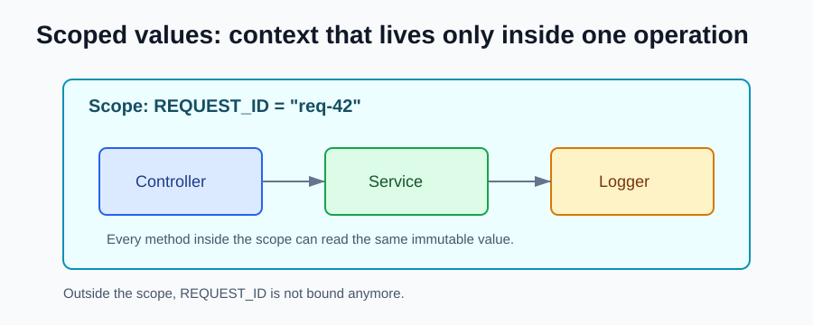

# Java 25 NEW Features

Java 25 is the latest LTS release. Compared with Java 21, it continues the work started by virtual threads: simpler concurrency, simpler beginner programs, better startup options, and stronger production diagnostics.



## Compact Source Files and Instance Main Methods

Small programs can now be written with less ceremony.

Before:

```java
public class Hello {
    public static void main(String[] args) {
        System.out.println("Hello Java");
    }
}
```

With Java 25:

```java
void main() {
    println("Hello Java");
}
```

This is useful for learning, scripts, examples, and small command-line tools.

## Module Import Declarations

You can import all packages exported by a module.

```java
import module java.base;

void main() {
    List<String> names = List.of("Ana", "Bruno");
    println(names);
}
```

This is especially nice for examples and small files because you do not need many individual imports.

## Scoped Values

Scoped values are an efficient way to share immutable context with code running in the same call flow, including virtual threads.

They are a better fit than `ThreadLocal` when the value should exist only for a well-defined operation.

```java
private static final ScopedValue<String> REQUEST_ID = ScopedValue.newInstance();

void handle(Request request) {
    ScopedValue.where(REQUEST_ID, request.id())
        .run(() -> service.process(request));
}

void process(Request request) {
    log.info("requestId={}", REQUEST_ID.get());
}
```

Think about request IDs, tenant IDs, authenticated user IDs, locale, or tracing context.

## Structured Concurrency Preview

Structured concurrency is still preview in Java 25, but it is more mature than in Java 21.

```java
try (var scope = StructuredTaskScope.open()) {
    Subtask<User> user = scope.fork(() -> userClient.findById(id));
    Subtask<List<Order>> orders = scope.fork(() -> orderClient.findByUser(id));

    scope.join();

    return new UserSummary(user.get(), orders.get());
}
```

The important idea is the same: if tasks belong together, their lifetime should be managed together.

## Flexible Constructor Bodies Preview

Constructors can do useful work before calling another constructor or the superclass constructor, while still keeping object initialization safe.

```java
class PositiveNumber {
    private final int value;

    PositiveNumber(String text) {
        int parsed = Integer.parseInt(text);

        if (parsed <= 0) {
            throw new IllegalArgumentException("Value must be positive");
        }

        this(parsed);
    }

    PositiveNumber(int value) {
        this.value = value;
    }
}
```

This makes validation and normalization in constructors easier to express.

This feature is preview in Java 25.

## Key Derivation Function API

Java 25 adds a standard API for key derivation functions. This helps applications derive cryptographic keys in a provider-independent way.

The practical benefit: security code can use standard JDK APIs instead of vendor-specific or hand-made helpers.

## PEM Encodings of Cryptographic Objects Preview

Java can work more directly with PEM encoded keys and certificates.

PEM is the common text format that looks like this:

```text
-----BEGIN PUBLIC KEY-----
...
-----END PUBLIC KEY-----
```

This feature is preview in Java 25.

## Better Flight Recorder Profiling

Java Flight Recorder keeps gaining better profiling events:

- CPU-time profiling helps show where CPU time is spent.
- Cooperative sampling improves stack traces for virtual threads.
- Method timing and tracing helps observe selected methods.

For production work, this means more useful diagnostics with low overhead.

## Compact Object Headers

Compact object headers reduce the memory used by Java objects. Applications with many small objects can benefit because each object needs less header space.

This is especially relevant for services with large heaps, caches, or many domain objects.

## Ahead-of-Time Ergonomics and Method Profiling

Java 25 improves startup and warmup work through ahead-of-time command-line ergonomics and method profiling.

The goal is to make it easier for applications to start faster and reach good performance sooner.

## Generational Shenandoah

Shenandoah gained a generational mode. Like Generational ZGC, it uses the fact that many objects die young to improve garbage collection behavior.

This matters for low-pause applications with lots of allocation.

## References

- OpenJDK JDK 25 project: https://openjdk.org/projects/jdk/25/
- Oracle Java SE Support Roadmap: https://www.oracle.com/java/technologies/java-se-support-roadmap.html
