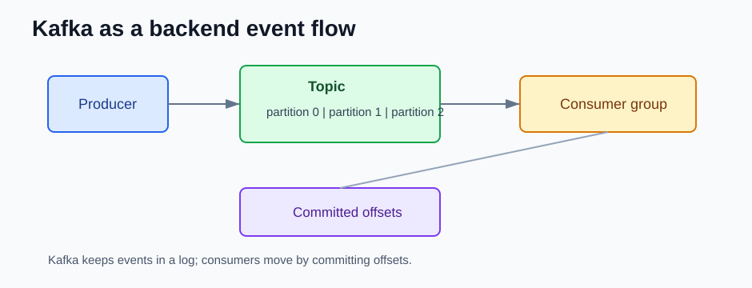

# Kafka Core Concepts for Backend Developers

This page is the short Kafka mental model that matters before reading version changes.



## Topic, Partition, Offset

```text
topic -> partitions -> ordered records
```

Kafka stores records in partitions. Each record has an offset. Consumers move through offsets.

## Consumer Groups

```text
consumer group -> partitions assigned to consumers
```

Consumer groups let multiple instances of a backend service share work. A partition is consumed by only one member of the group at a time.

## Retention and Replay

Kafka keeps records based on retention settings, not whether a consumer already read them.

That means a backend service can replay old events if the data is still retained.

## Ordering

Kafka ordering is per partition, not across the whole topic.

Use a stable key when order matters:

```java
producer.send(new ProducerRecord<>("orders", orderId, event));
```

## Streams vs Connect

Use Kafka Streams for business event processing inside an application.

Use Kafka Connect for moving data between systems.

## References

- Apache Kafka documentation: https://kafka.apache.org/documentation/
