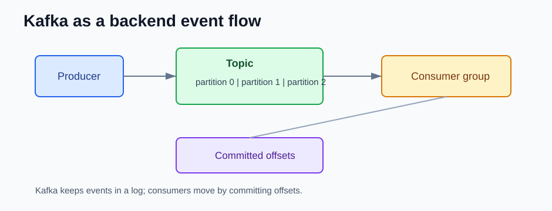

# Kafka for Backend Developers

Apache Kafka does not use Java-style LTS labels in the official Apache release list. For this stack, the pages use Kafka minor release branches from 2018 onward.

Each page compares the version group with the previous listed Kafka version group and focuses only on what matters to backend engineers.



## Versions

- [Kafka Core Concepts](kafka-core.md)
- [Kafka 4.1 to 4.3](kafka41-43.md)
- [Kafka 4.0](kafka40.md)
- [Kafka 3.5 to 3.9](kafka35-39.md)
- [Kafka 3.0 to 3.4](kafka30-34.md)
- [Kafka 2.0 to 2.8](kafka20-28.md)

## Backend Mental Model

```text
producer -> topic partitions -> consumer group -> backend processing
                                   |
                                   +-> committed offsets
```

Kafka is not just a queue. It is a durable event log. Consumers read records from partitions, commit offsets, and can replay old data when retention allows it.

## References

- Apache Kafka downloads: https://kafka.apache.org/downloads/
- Apache Kafka blog releases: https://kafka.apache.org/blog/
- Apache Kafka documentation: https://kafka.apache.org/documentation/
