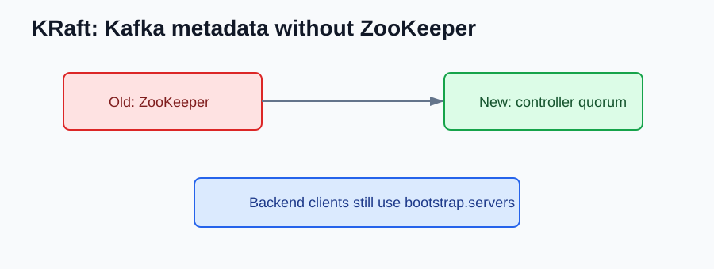

# Kafka 2.0 to 2.8 NEW Features

Compared with Kafka 1.x, the Kafka 2.x line is where Kafka becomes a stronger backend event platform: better clients, Kafka Streams, Kafka Connect, compression, and the first KRaft preview.

## Backend Event Flow

Kafka is a durable event log. Backend services produce events, consumers read partitions, and consumer groups commit offsets.

```text
producer -> topic partitions -> consumer group -> backend processing
```

## Kafka Streams

Kafka Streams lets a backend service process events without running a separate stream-processing cluster.

```java
builder.stream("orders")
    .filter((key, order) -> order.isPaid())
    .to("paid-orders");
```

Use it for service-owned transformations, projections, joins, and aggregations.

## Kafka Connect

Kafka Connect is for data movement, not business logic.

```text
database -> source connector -> Kafka -> sink connector -> search index
```

Use it for integration plumbing. Keep business rules in services or Streams apps.

## Compression and Reliability

```properties
compression.type=zstd
enable.idempotence=true
acks=all
```

Benchmark compression before enabling it everywhere.

## KRaft Preview in 2.8

Kafka 2.8 introduced the early path toward Kafka metadata without ZooKeeper.



Backend clients still use brokers:

```properties
bootstrap.servers=kafka:9092
```

## What should I check after upgrading?

- Verify producer reliability settings.
- Watch consumer lag and rebalance behavior.
- Test Kafka Streams state restore.
- Keep services using brokers, not ZooKeeper.

## References

- Apache Kafka 2.0 documentation: https://kafka.apache.org/20/documentation.html
- Apache Kafka 2.8 documentation: https://kafka.apache.org/28/documentation.html
