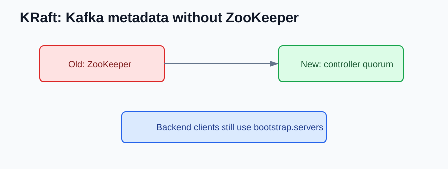

# Kafka 3.0 to 3.4 NEW Features

Compared with Kafka 2.8, early Kafka 3.x is mainly about KRaft becoming real and the ecosystem preparing for Kafka without ZooKeeper.

## Major Upgrade Checkpoint

Kafka 3.0 starts a new major line.

Backend teams should check:

- `kafka-clients`
- Spring Kafka
- Kafka Streams
- Kafka Connect plugins
- schema registry client
- Testcontainers Kafka support

## KRaft Becomes More Relevant

Kafka 3.3 made the ZooKeeper-free direction much more practical for real clusters.



Backend services should still connect through brokers:

```properties
bootstrap.servers=kafka:9092
```

Avoid service code or scripts that depend on ZooKeeper.

## Streams and Connect Compatibility

The critical backend concern is whether event processing still behaves the same after broker/client upgrades.

Retest:

```text
input topic -> stream app -> output topic
database -> connector -> topic
topic -> connector -> external system
```

## What should I check after upgrading?

- Run integration tests with actual service client versions.
- Remove ZooKeeper assumptions from local tooling.
- Test consumer group rebalances during deploys.
- Test Streams state restore and Connect task restarts.

## References

- Apache Kafka 3.0 documentation: https://kafka.apache.org/30/documentation.html
- Apache Kafka 3.4 documentation: https://kafka.apache.org/34/documentation.html
