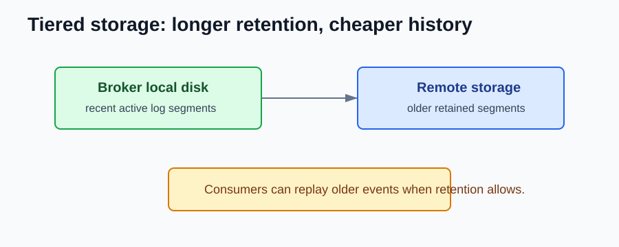

# Kafka 3.5 to 3.9 NEW Features

Compared with Kafka 3.4, this period is about tiered storage becoming production-ready and teams preparing for Kafka 4.0.

## Tiered Storage

Tiered storage moves older log segments to remote storage while recent data stays local.



Backend value:

- longer event retention
- cheaper historical storage
- replay for rebuilds and audits

## Replay Changes

Reading old events may involve remote storage.

```text
consumer replay -> broker -> local segment or remote segment
```

Design replay jobs and backfills to handle different latency than live consumption.

## Preparing for Kafka 4.0

Kafka 3.9 is the last 3.x line before Kafka 4.0.

Remove assumptions like:

```text
my service needs ZooKeeper connection info
```

Normal backend clients should only need:

```properties
bootstrap.servers=kafka:9092
```

## What should I check after upgrading?

- Test replay from old offsets.
- Review retention expectations with platform teams.
- Watch lag and fetch latency during backfills.
- Make sure services do not depend on ZooKeeper.

## References

- Apache Kafka 3.5 documentation: https://kafka.apache.org/35/documentation.html
- Apache Kafka 3.8 release announcement: https://kafka.apache.org/blog/2024/07/29/apache-kafka-3.8.0-release-announcement/
- Apache Kafka 3.9 release announcement: https://kafka.apache.org/blog/2024/11/06/apache-kafka-3.9.0-release-announcement/
