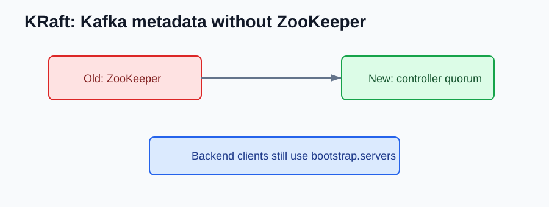

# Kafka 4.0 NEW Features

Compared with Kafka 3.9, Kafka 4.0 is the most important modern Kafka migration: ZooKeeper mode is gone.

## KRaft Only

Kafka 4.0 removed the ZooKeeper-based metadata mode.



Old cluster shape:

```text
Kafka brokers + ZooKeeper
```

New cluster shape:

```text
Kafka brokers + Kafka controller quorum
```

Backend services should still connect with:

```properties
bootstrap.servers=kafka-1:9092,kafka-2:9092
```

## Backend Compatibility

Kafka 4.0 is a major-version upgrade. Check framework and client compatibility before moving services.

Examples:

- Spring Kafka
- Kafka Streams
- Kafka Connect plugins
- schema registry client
- Testcontainers Kafka module

## What should I check after upgrading?

- Remove ZooKeeper assumptions from docs, scripts, and local Compose files.
- Test all client libraries against Kafka 4.
- Watch consumer group behavior during rolling deploys.
- Retest Kafka Streams state recovery.

## References

- Apache Kafka 4.0 documentation: https://kafka.apache.org/40/documentation.html
- Apache Kafka 4.0 release announcement: https://kafka.apache.org/blog/2025/03/18/apache-kafka-4.0.0-release-announcement/
