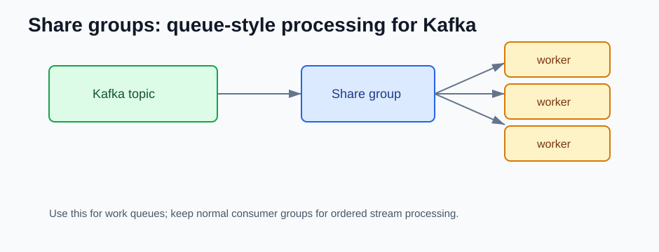
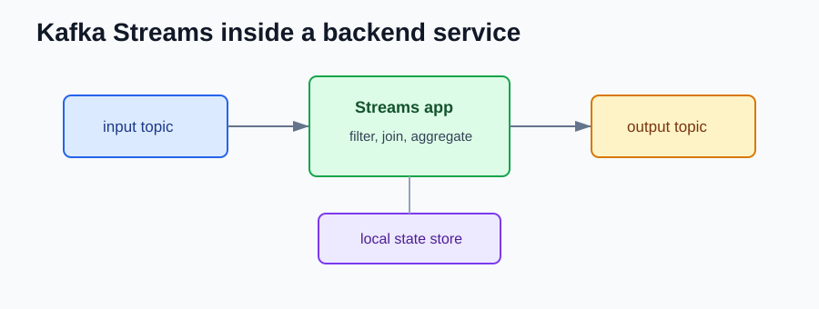

# Kafka 4.1 to 4.3 NEW Features

Compared with Kafka 4.0, Kafka 4.1 to 4.3 improves the KRaft-only world and adds more backend-relevant work around queue-style processing, tiered storage, auth, and Kafka Streams.

## Share Groups

Traditional consumer groups assign partitions to consumers. That is good for ordered stream processing, but parallelism is tied to partition count.

Share groups are designed for queue-like workloads where many workers can cooperatively process records.



Use this for work queues:

```text
email-events -> many workers send emails
```

Do not replace normal consumer groups blindly. If strict per-key ordering matters, stay careful.

## Tiered Storage Improvements

Kafka 4.3 added more configuration and metrics around tiered storage.

Backend impact:

- replay visibility
- better retention planning
- safer backfills

## OAuth Client Assertion Support

Kafka 4.3 added OAuth client assertion support with the client credentials grant type.

This matters for backend services that authenticate to Kafka using OAuth providers that require client assertions.

## Kafka Streams Improvements

Kafka 4.3 improved Streams behavior around state stores and exception handling.



Backend services with Streams should test state recovery and exception handling before upgrading production.

## What should I check after upgrading?

- Decide whether the workload is stream-style or queue-style.
- Test share-group failure and retry behavior before adopting it.
- Test OAuth authentication in lower environments.
- Watch tiered storage metrics during replay.
- Retest Kafka Streams state recovery.

## References

- Apache Kafka 4.1 release announcement: https://kafka.apache.org/blog/2025/09/04/apache-kafka-4.1.0-release-announcement/
- Apache Kafka 4.2 release announcement: https://kafka.apache.org/blog/2026/02/17/apache-kafka-4.2.0-release-announcement/
- Apache Kafka 4.3 release announcement: https://kafka.apache.org/blog/2026/05/22/apache-kafka-4.3.0-release-announcement/
